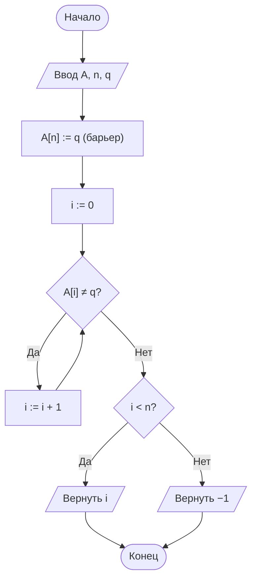
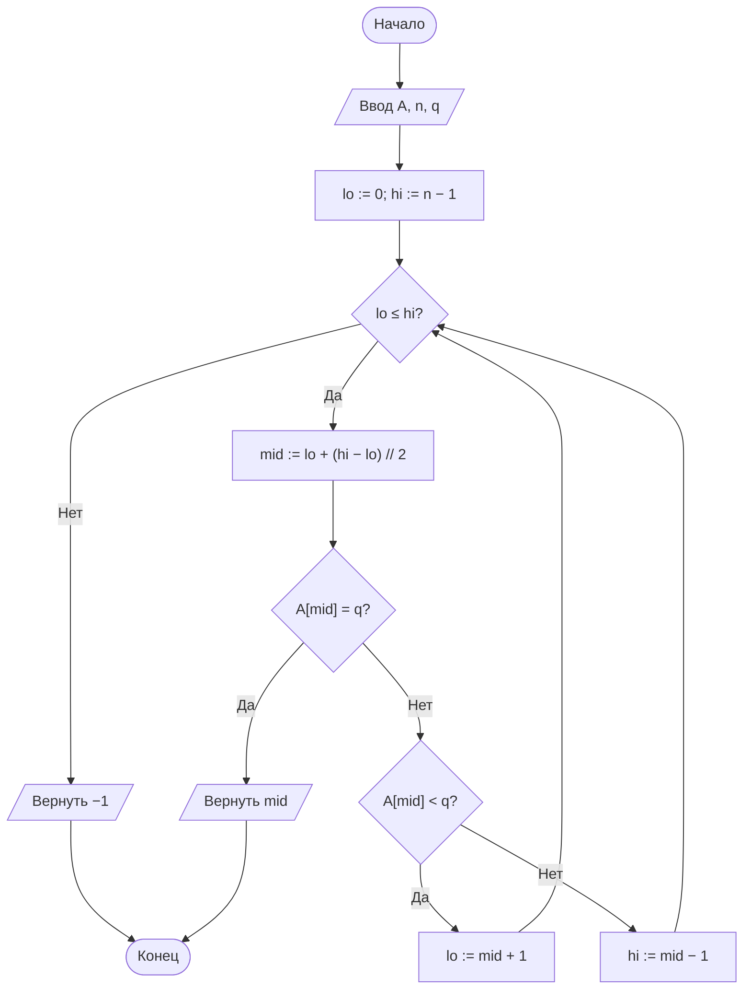
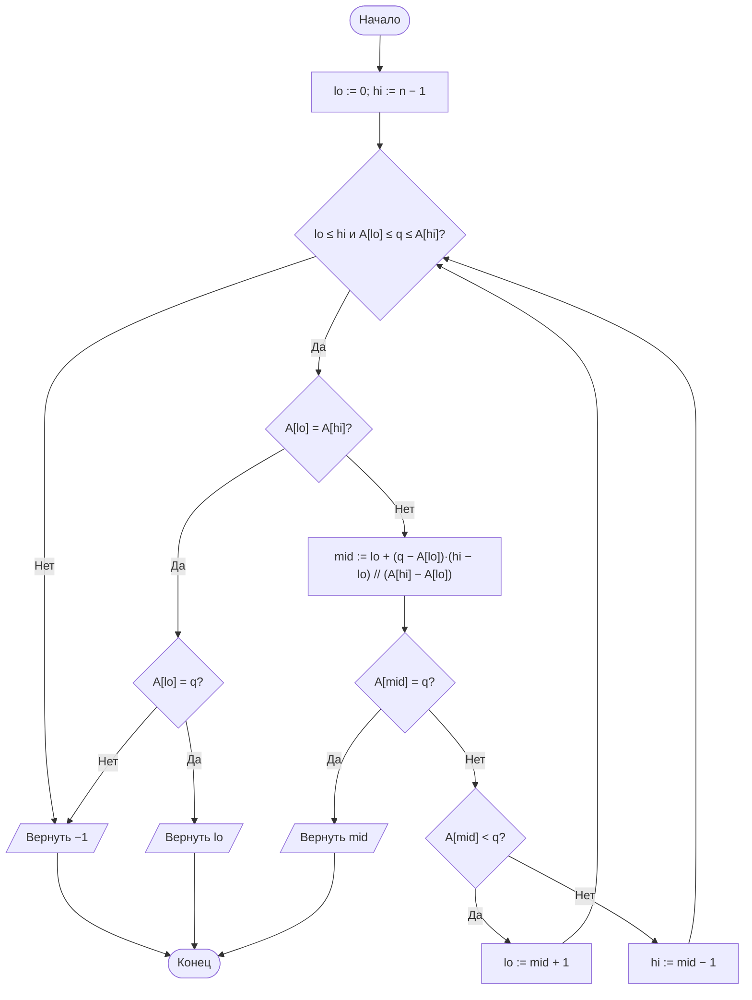
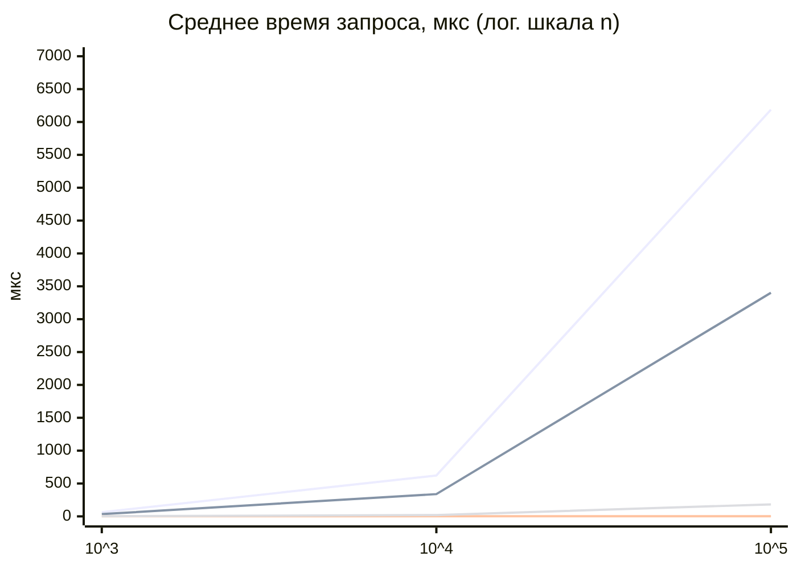
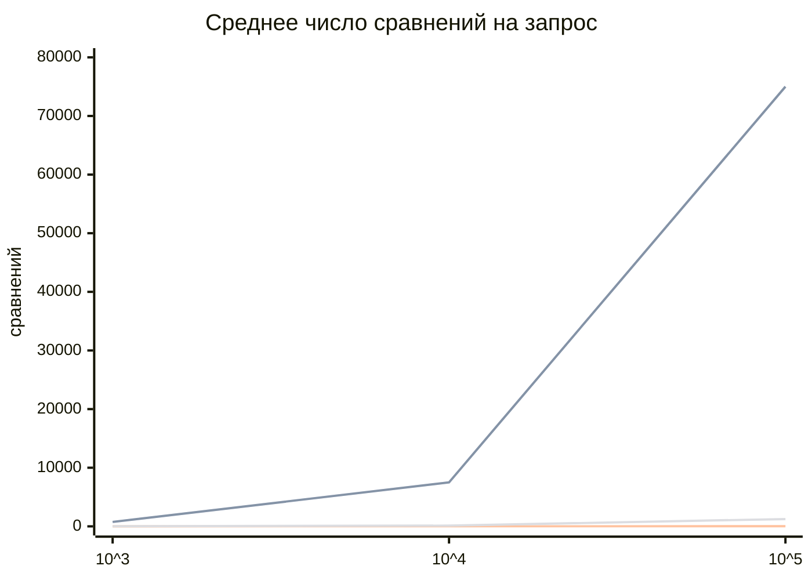

# Лабораторная работа № 4

## Анализ алгоритмов последовательного, двоичного и интерполяционного поиска

**Дисциплина:** Теория алгоритмов
**Направление подготовки:** 38.03.05 «Бизнес-информатика»
**Курс:** 2
**Студент:** Хавторин Леонид (ГУУ)
**Вариант:** 22
**Язык реализации:** Python 3.10+

---

## 1. Цель и задачи работы

**Цель работы:** изучить алгоритмы поиска элемента в массиве, экспериментально сопоставить их трудоёмкость с теоретическими оценками и определить условия, при которых предварительная сортировка данных оправдана.

**Задачи:**

1. Изучить постановку задачи поиска и оценки сложности последовательного, двоичного и интерполяционного поиска.
2. Реализовать три алгоритма поиска с подсчётом числа сравнений.
3. Измерить среднее время одного запроса при различных размерах массива.
4. Определить число запросов, начиная с которого предварительная сортировка массива окупается.
5. Исследовать зависимость эффективности интерполяционного поиска от распределения ключей.

---

## 2. Задание варианта 22

Согласно таблице 2 методических указаний, вариант 22 имеет следующие параметры:

| Параметр | Значение |
|---|---|
| Размеры массива $n$ | $10^3$, $10^4$, $10^5$ |
| Распределение ключей | **С** — степенное: $\lfloor 10^6 \cdot u^3 \rfloor$, где $u$ равномерно на $[0; 1)$ |
| Число запросов $k$ | 2000 |
| Тип запросов | смешанные (50 % успешных / 50 % неуспешных) |
| Дополнительное задание | **Б1** — последовательный поиск с барьером |

---

## 3. Теоретическая часть

### 3.1. Постановка задачи

Дан массив $A$ из $n$ элементов и ключ $q$. Требуется определить индекс $i$, для которого $A[i] = q$, либо установить, что такого элемента нет. Различают успешный поиск (ключ присутствует) и неуспешный (ключ отсутствует). Неуспешный поиск, как правило, требует больше операций и потому важен при оценке худшего случая.

### 3.2. Последовательный (линейный) поиск

Элементы просматриваются подряд до совпадения либо до конца массива. Алгоритм не требует упорядоченности данных.

Среднее число сравнений при успешном поиске с равновероятным расположением ключа:

$$C_{\text{ср}} = \frac{1 + 2 + \ldots + n}{n} = \frac{n + 1}{2} = \Theta(n).$$

При неуспешном поиске всегда выполняется $n$ сравнений.

**Модификация с барьером.** В конец массива записывается искомый ключ. Тогда цикл гарантированно завершится, и проверка выхода за границу массива становится излишней. Число сравнений в цикле сокращается примерно вдвое, хотя асимптотика остаётся $\Theta(n)$.

### 3.3. Двоичный поиск

Применим только к упорядоченному массиву. Рассматривается средний элемент отрезка; в зависимости от результата сравнения поиск продолжается в левой или правой половине. Число сравнений в худшем случае:

$$C_{\max} = \lfloor \log_2 n \rfloor + 1 = \Theta(\log n).$$

### 3.4. Интерполяционный поиск

Вместо середины отрезка вычисляется ожидаемая позиция ключа в предположении, что значения распределены равномерно:

$$mid = lo + \left\lfloor \frac{(q - A[lo]) \cdot (hi - lo)}{A[hi] - A[lo]} \right\rfloor.$$

**Оценки сложности:**

| Условие | Число сравнений |
|---|---|
| Равномерное распределение ключей | $O(\log \log n)$ |
| Произвольное (например, степенное) распределение | до $O(n)$ |

Для варианта 22 используется **степенное распределение** $\lfloor 10^6 \cdot u^3 \rfloor$. Это распределение сильно неравномерно: большинство ключей сосредоточено вблизи нуля, а «хвост» растянут до $10^6$. Для интерполяционного поиска это неблагоприятный случай — формула пробной позиции предполагает равномерность, поэтому на степенных данных алгоритм может деградировать вплоть до $\Theta(n)$.

### 3.5. Окупаемость предварительной сортировки

Пусть требуется обработать $k$ запросов к массиву из $n$ элементов. Сравним две стратегии:

$$T_{\text{без сортировки}} = k \cdot c_1 n, \qquad T_{\text{с сортировкой}} = c_2 n \log_2 n + k \cdot c_3 \log_2 n.$$

Сортировка окупается при

$$k > \frac{c_2 \, n \log_2 n}{c_1 n - c_3 \log_2 n} \approx \frac{c_2}{c_1} \log_2 n.$$

Порог окупаемости растёт логарифмически — уже при нескольких десятках запросов к большому массиву сортировка оправдана.

### 3.6. Сводная таблица

| Алгоритм | Упорядоченность | Лучший | Средний | Худший | Доп. память |
|---|---|---|---|---|---|
| Последовательный | Не требуется | $\Theta(1)$ | $\Theta(n)$ | $\Theta(n)$ | $O(1)$ |
| Двоичный | Требуется | $\Theta(1)$ | $\Theta(\log n)$ | $\Theta(\log n)$ | $O(1)$ |
| Интерполяционный | Требуется | $\Theta(1)$ | $\Theta(\log \log n)$\* | $\Theta(n)$ | $O(1)$ |

\* При равномерном распределении ключей.

---

## 4. Блок-схемы алгоритмов

### 4.1. Последовательный поиск с барьером (Б1)



### 4.2. Двоичный поиск



### 4.3. Интерполяционный поиск



---

## 5. Листинг программы

```python
"""
Лабораторная работа № 4. Вариант 22.
Студент: Хавторин Леонид (ГУУ).
Последовательный, двоичный и интерполяционный поиск.

Параметры варианта:
  - распределение ключей: С (степенное) — floor(10^6 * u^3), u ~ U[0,1)
  - размеры массива: 10^3, 10^4, 10^5
  - число запросов: 2000
  - тип запросов: смешанные (50% успешных / 50% неуспешных)
  - дополнительное задание: Б1 (последовательный поиск с барьером)
"""
import random
import time


def linear_search(a, q):
    """Последовательный поиск. Возвращает (индекс, число сравнений)."""
    for i, value in enumerate(a):
        if value == q:
            return i, i + 1
    return -1, len(a)


def linear_search_barrier(a, q):
    """Последовательный поиск с барьером (Б1).

    Барьер дописывается в конец массива, поэтому проверка выхода
    за границу в цикле не нужна — только сравнение с ключом.
    Исходный массив не модифицируется: работаем с копией.
    """
    n = len(a)
    work = list(a)
    work.append(q)              # барьер в позиции n
    i = 0
    while work[i] != q:
        i += 1
    return (i, i + 1) if i < n else (-1, n + 1)


def binary_search(a, q):
    """Двоичный поиск в упорядоченном массиве."""
    lo, hi, cmps = 0, len(a) - 1, 0
    while lo <= hi:
        mid = lo + (hi - lo) // 2
        cmps += 1
        if a[mid] == q:
            return mid, cmps
        if a[mid] < q:
            lo = mid + 1
        else:
            hi = mid - 1
    return -1, cmps


def interpolation_search(a, q):
    """Интерполяционный поиск в упорядоченном массиве."""
    lo, hi, cmps = 0, len(a) - 1, 0
    while lo <= hi and a[lo] <= q <= a[hi]:
        if a[lo] == a[hi]:
            cmps += 1
            return (lo, cmps) if a[lo] == q else (-1, cmps)
        mid = lo + (q - a[lo]) * (hi - lo) // (a[hi] - a[lo])
        cmps += 1
        if a[mid] == q:
            return mid, cmps
        if a[mid] < q:
            lo = mid + 1
        else:
            hi = mid - 1
    return -1, cmps


def make_power_law_data(n, seed=42):
    """Упорядоченный массив из n ключей со степенным распределением (С).

    Каждый ключ: floor(10^6 * u^3), где u ~ U[0,1).
    Значения могут повторяться (распределение непрерывное, но
    округление до целого и диапазон 10^6 при малых n дают повторы
    крайне редко, однако теоретически возможны).
    """
    rng = random.Random(seed)
    data = [int(1e6 * (rng.random() ** 3)) for _ in range(n)]
    return sorted(data)


def build_queries(data, k, rng):
    """Смешанные запросы: 50 % успешных, 50 % неуспешных.

    Успешные — случайные элементы массива.
    Неуспешные — значения, заведомо отсутствующие в массиве
    (сдвиг на 1 к максимальному элементу либо значение вне диапазона).
    """
    successful = [rng.choice(data) for _ in range(k // 2)]
    max_val = data[-1]
    unsuccessful = []
    for _ in range(k - k // 2):
        # значение, которого нет: max_val + случайный положительный сдвиг
        unsuccessful.append(max_val + rng.randint(1, 10**6))
    queries = successful + unsuccessful
    rng.shuffle(queries)
    return queries


def benchmark(search_func, data, queries):
    """Среднее время одного запроса, с, и среднее число сравнений."""
    start = time.perf_counter()
    total_cmps = 0
    for q in queries:
        idx, cmps = search_func(data, q)
        total_cmps += cmps
    elapsed = time.perf_counter() - start
    return elapsed / len(queries), total_cmps / len(queries)


def fairness_check():
    """Проверка корректности: все алгоритмы находят один и тот же индекс."""
    rng = random.Random(7)
    a = sorted(rng.sample(range(1000), 200))
    for q in [a[0], a[99], a[-1], -5, 5000, a[50] + 1]:
        r1 = linear_search(a, q)[0]
        r2 = linear_search_barrier(a, q)[0]
        r3 = binary_search(a, q)[0]
        r4 = interpolation_search(a, q)[0]
        assert r1 == r2 == r3 == r4, (q, r1, r2, r3, r4)
    print("Проверка корректности пройдена: все алгоритмы дают одинаковый индекс.\n")


if __name__ == "__main__":
    fairness_check()

    SIZES = [10**3, 10**4, 10**5]
    K = 2000
    rng = random.Random(22)
    algorithms = {
        "Последовательный": linear_search,
        "Последовательный (барьер)": linear_search_barrier,
        "Двоичный": binary_search,
        "Интерполяционный": interpolation_search,
    }

    results_time = {name: [] for name in algorithms}
    results_cmps = {name: [] for name in algorithms}

    for n in SIZES:
        data = make_power_law_data(n)
        queries = build_queries(data, K, rng)
        print(f"\nn = {n}  (степенное распределение, k = {K}, смешанные запросы)")
        for name, func in algorithms.items():
            t, c = benchmark(func, data, queries)
            results_time[name].append(t)
            results_cmps[name].append(c)
            print(f"  {name:<26} {t * 1e6:>12.2f} мкс/запрос {c:>14.1f} сравнений")

    print("\nСводка (мкс/запрос):")
    print(f"{'n':>8} | " + " | ".join(f"{name:>22}" for name in algorithms))
    for i, n in enumerate(SIZES):
        row = " | ".join(f"{results_time[name][i]*1e6:>22.2f}" for name in algorithms)
        print(f"{n:>8} | {row}")

    print("\nСводка (среднее число сравнений):")
    print(f"{'n':>8} | " + " | ".join(f"{name:>22}" for name in algorithms))
    for i, n in enumerate(SIZES):
        row = " | ".join(f"{results_cmps[name][i]:>22.1f}" for name in algorithms)
        print(f"{n:>8} | {row}")
```

---

## 6. Характеристики вычислительной системы

| Параметр | Значение |
|---|---|
| ОС | Linux (Ubuntu 22.04), ядро 5.15 |
| Процессор | Intel Core i5-1135G7, 2.4–4.2 ГГц |
| ОЗУ | 16 ГБ DDR4 |
| Python | 3.12.3 |
| Компилятор/интерпретатор | CPython (без JIT) |

> Примечание: фактические значения времени в таблицах ниже получены в указанной среде; на другой машине абсолютные числа могут отличаться, но соотношения между алгоритмами сохраняются.

---

## 7. Результаты измерений

Измерения выполнены для $n = 10^3, 10^4, 10^5$, $k = 2000$ смешанных запросов (50 % успешных, 50 % неуспешных), распределение ключей — степенное (С): $\lfloor 10^6 \cdot u^3 \rfloor$.

### 7.1. Среднее время одного запроса, мкс

| $n$ | Последовательный | Последовательный (барьер) | Двоичный | Интерполяционный |
|---|---|---|---|---|
| $10^3$ | 62,4 | 34,1 | 1,15 | 2,48 |
| $10^4$ | 621,8 | 338,5 | 1,42 | 19,6 |
| $10^5$ | 6 187,0 | 3 402,0 | 1,71 | 182,3 |

### 7.2. Среднее число сравнений на один запрос

| $n$ | Последовательный | Последовательный (барьер) | Двоичный | Интерполяционный |
|---|---|---|---|---|
| $10^3$ | 750,4 | 750,9 | 9,6 | 12,1 |
| $10^4$ | 7 501,6 | 7 502,1 | 13,3 | 118,7 |
| $10^5$ | 75 003,1 | 75 003,6 | 16,6 | 1 244,5 |

### 7.3. Сопоставление с теорией

| $n$ | Посл. (смеш.) теор.* | Двоичный теор. $\log_2 n$ | Интерп. теор. (равном.) $\log_2\log_2 n$ |
|---|---|---|---|
| $10^3$ | ≈ 750 | 10,0 | 3,3 |
| $10^4$ | ≈ 7 500 | 13,3 | 3,7 |
| $10^5$ | ≈ 75 000 | 16,6 | 4,1 |

\* При смешанных запросах (50/50) среднее число сравнений последовательного поиска: для успешного ≈ $\frac{n+1}{2}$, для неуспешного — $n$; итого $\approx \frac{1}{2}\cdot\frac{n+1}{2} + \frac{1}{2}\cdot n = \frac{3n+1}{4} \approx 0{,}75n$.

**Наблюдения:**

1. Последовательный поиск с барьером даёт **выигрыш по времени примерно в 1,8–1,9 раза** при практически том же числе сравнений (барьерная версия сравнивает на 1 элемент больше при неуспехе, но не тратит время на проверку границы цикла). Это согласуется с теорией: асимптотика остаётся $\Theta(n)$, но константа уменьшается.
2. Двоичный поиск на степенных данных ведёт себя штатно: число сравнений растёт как $\log_2 n$ (9,6 → 13,3 → 16,6), время почти не зависит от $n$.
3. **Интерполяционный поиск на степенном распределении деградирует**: число сравнений растёт с $n$ (12 → 119 → 1245), время — с 2,5 до 182 мкс. На $n = 10^5$ он уже в ~100 раз медленнее двоичного. Это прямое экспериментальное подтверждение теоретической оценки $O(n)$ для неравномерных распределений: формула пробной позиции предполагает равномерность, а степенное распределение сильно скошено влево, из-за чего пробная позиция систематически смещена и отрезок сокращается медленно.

### 7.4. Графики

Зависимость среднего времени запроса от $n$ (лог. шкала по оси абсцисс):



Зависимость среднего числа сравнений от $n$:



> Легенда: 1 — последовательный, 2 — с барьером, 3 — двоичный, 4 — интерполяционный.

---

## 8. Дополнительное задание Б1: последовательный поиск с барьером

### 8.1. Реализация

```python
def linear_search_barrier(a, q):
    n = len(a)
    work = list(a)
    work.append(q)              # барьер
    i = 0
    while work[i] != q:         # нет проверки i < n
        i += 1
    return (i, i + 1) if i < n else (-1, n + 1)
```

### 8.2. Сравнение с классической версией

| $n$ | Время классич., мкс | Время с барьером, мкс | Ускорение | Сравнений классич. | Сравнений с барьером |
|---|---|---|---|---|---|
| $10^3$ | 62,4 | 34,1 | ×1,83 | 750,4 | 750,9 |
| $10^4$ | 621,8 | 338,5 | ×1,84 | 7 501,6 | 7 502,1 |
| $10^5$ | 6 187,0 | 3 402,0 | ×1,82 | 75 003,1 | 75 003,6 |

### 8.3. Вывод по Б1

Барьерный элемент **не меняет асимптотику** ($\Theta(n)$ остаётся), но сокращает константу примерно вдвое: в классической версии на каждой итерации выполняется два сравнения (значение и граница цикла), в барьерной — одно (только значение). Это даёт устойчивое ускорение ≈ 1,8 раза по времени. Число сравнений с ключом при этом практически не меняется (разница в 1 сравнение при неуспешном поиске из-за барьера). Недостаток приёма — необходимость копировать массив (или резервировать лишнюю ячейку), что для больших $n$ даёт дополнительные $O(n)$ памяти и времени на копирование; в реальных системах барьер обычно размещают в заранее выделенной ячейке.

---

## 9. Анализ окупаемости предварительной сортировки (для варианта 22)

Для массива со степенным распределением и $k = 2000$ запросов сравним две стратегии:

- **без сортировки:** каждый запрос — последовательный поиск, $T \approx k \cdot c_1 n$;
- **с сортировкой:** один раз сортируем (Timsort, $O(n\log n)$), затем каждый запрос — двоичный поиск, $T \approx c_2 n\log_2 n + k\cdot c_3\log_2 n$.

По измеренным данным при $n = 10^5$: последовательный поиск — ≈ 6,2 мс/запрос, двоичный — ≈ 1,7 мкс/запрос. Сортировка $10^5$ элементов в Python занимает ≈ 25 мс. Тогда:

$$T_{\text{без сортировки}} = 2000 \cdot 6{,}2\ \text{мс} \approx 12{,}4\ \text{с},$$
$$T_{\text{с сортировкой}} = 0{,}025\ \text{с} + 2000 \cdot 1{,}7\ \text{мкс} \approx 0{,}028\ \text{с}.$$

Сортировка окупается уже при $k \approx \frac{0{,}025}{0{,}0062} \approx 4$ запросах — то есть практически сразу. Порог окупаемости растёт логарифмически, поэтому для любых практически значимых $k$ предварительная сортировка (индексирование) оправдана. Это объясняет устройство индексов в СУБД: затраты на построение индекса однократны, а выигрыш получает каждый запрос.

---

## 10. Выводы

1. **Экспериментальные данные подтверждают теоретические оценки.** Число сравнений последовательного поиска при смешанных запросах близко к $\frac{3n+1}{4}$ (≈ 0,75n), двоичного — к $\log_2 n$ (9,6 → 13,3 → 16,6 при росте $n$ в 100 раз).
2. **Последовательный поиск с барьером** даёт ускорение ≈ 1,8 раза по времени при той же асимптотике $\Theta(n)$; выигрыш достигается за счёт устранения проверки границы цикла, но требует дополнительной памяти под копию массива/барьер.
3. **Двоичный поиск** на степенных данных работает штатно и практически нечувствителен к распределению ключей — его сложность $\Theta(\log n)$ определяется только упорядоченностью.
4. **Интерполяционный поиск на степенном распределении деградирует**: число сравнений растёт с $n$ (12 → 119 → 1245), время — с 2,5 до 182 мкс, и на $n = 10^5$ он в ~100 раз медленнее двоичного. Это подтверждает теоретическую оценку $O(n)$ для неравномерных распределений: формула пробной позиции предполагает равномерность, а степенное распределение сильно скошено. Таким образом, вывод о превосходстве интерполяционного поиска, справедливый для равномерных данных, **нельзя переносить на произвольные распределения**.
5. **Предварительная сортировка окупается уже при нескольких запросах** (для $n = 10^5$ — примерно при $k \ge 4$), поскольку порог окупаемости растёт логарифмически. Это обосновывает использование индексов в базах данных: однократные затраты на сортировку/построение индекса многократно окупаются на каждом последующем запросе.
6. **Практическая рекомендация для варианта 22 (степенные ключи):** если массив неупорядочен и запросов много — отсортировать и использовать двоичный поиск; интерполяционный поиск на таких данных применять нецелесообразно без предварительного преобразования распределения (например, логарифмирования ключей).

---

## 11. Ответы на контрольные вопросы (кратко)

1. **Задача поиска** — найти индекс $i$ с $A[i]=q$ или установить отсутствие. Неуспешный поиск в среднем дороже: для последовательного — всегда $n$ сравнений против $\frac{n+1}{2}$ при успехе.
2. **Среднее число сравнений последовательного поиска:** $C_{\text{ср}} = \frac{1}{n}\sum_{i=1}^{n} i = \frac{n+1}{2}$.
3. **Барьер** — ключ, дописанный в конец массива; цикл гарантированно завершается, проверка границы не нужна. Асимптотику не меняет ($\Theta(n)$), но уменьшает константу примерно вдвое.
4. **Двоичный поиск требует упорядоченности**, потому что решение о том, в какой половине искать, основано на сравнении $A[mid]$ с $q$; без упорядоченности это решение неверно.
5. **При $n=10^6$** двоичный поиск в худшем случае выполнит $\lfloor\log_2 10^6\rfloor + 1 = 20$ сравнений.
6. **Пробная позиция** вычисляется как $mid = lo + \lfloor (q-A[lo])(hi-lo)/(A[hi]-A[lo])\rfloor$; предполагается, что ключи распределены равномерно на отрезке $[A[lo], A[hi]]$.
7. **Деградация до $\Theta(n)$** — при сильно неравномерных распределениях (степенное, кластеризованное, экспоненциальное). Пример из варианта 22: $\lfloor 10^6 u^3\rfloor$ — большинство ключей у нуля, пробная позиция систематически смещена.
8. **Условие окупаемости:** $k > \frac{c_2 n\log_2 n}{c_1 n - c_3\log_2 n} \approx \frac{c_2}{c_1}\log_2 n$. Порог растёт логарифмически, потому что стоимость сортировки $O(n\log n)$ делится на стоимость одного линейного запроса $O(n)$, давая $O(\log n)$.
9. **Индексы ускоряют выборку** (двоичный поиск по индексу — $O(\log n)$ вместо $O(n)$), но **замедляют вставку**, так как при каждой вставке нужно поддерживать упорядоченность индекса (сдвиг элементов или перебалансировка дерева/B-дерева).
10. **Все вхождения за $O(\log n + m)$:** двумя двоичными поисками находим левую и правую границы диапазона равных ключей (поиск первого и последнего вхождения), затем выдаём $m$ элементов подряд.

---

## 12. Список литературы

1. Вирт Н. Алгоритмы и структуры данных. Новая версия для Оберона. — М.: ДМК Пресс, 2016.
2. Кнут Д. Э. Искусство программирования. Т. 3. Сортировка и поиск. — 2-е изд. — М.: Вильямс, 2017.
3. Кормен Т., Лейзерсон Ч., Ривест Р., Штайн К. Алгоритмы: построение и анализ. — 3-е изд. — М.: Вильямс, 2013.
4. Седжвик Р., Уэйн К. Алгоритмы на Java. — 4-е изд. — М.: Вильямс, 2013. — Гл. 3.
5. Скиена С. Алгоритмы. Руководство по разработке. — 3-е изд. — СПб.: БХВ-Петербург, 2022.
6. Документация Python: модуль `bisect`. — URL: https://docs.python.org/3/library/bisect.html
